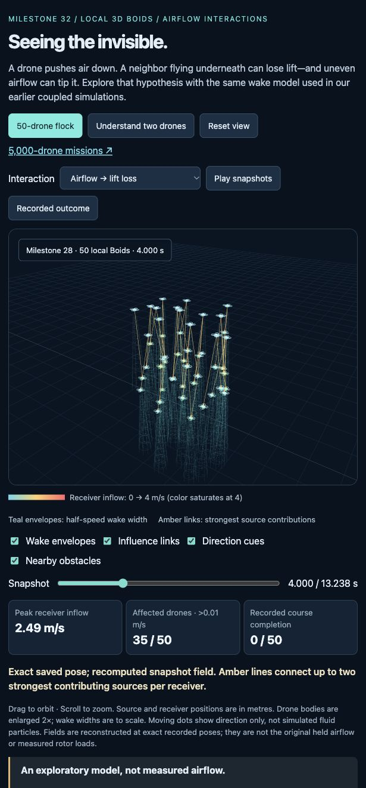

# Drone Swarm Aerodynamics — Public Research Snapshot

Research into **which approximations of mutual aerodynamic interaction preserve useful physical predictions while enabling locally controlled 3D drone flocks within browser compute budgets**, scaling toward 5,000 drones using WebGPU.

This is an ongoing research record, including unsuccessful experiments. The historical numerical pipeline runs offline on CPU; a new receiver-only component has also been evaluated on actual browser WebGPU. Three.js displays recorded trajectories and numerical evidence. A validated 5,000-drone, airflow-coupled WebGPU simulation has **not** been demonstrated.



## Current Milestone 31 restart

Latest checkpoint: [exact reference checks at 180 drones](research/m31-prepared-capacity-2026-10-17/MILESTONE-SUMMARY.md). The fixed 64/180/180 cases passed saved-result accuracy checks and the predeclared offline cost hurdle; independent saved-data audit passed. Dense and sparse 180-drone calculations took 12.317 and 1.754 seconds with profiling enabled. These are single-run offline observations, not browser frame times or a speedup. [Updated Three.js evidence](research/m31-prepared-capacity-2026-10-17/viewer/) · [Claims](research/m31-prepared-capacity-2026-10-17/CLAIMS.md) · [Restart](research/m31-prepared-capacity-2026-10-17/RESTART.md). The separate [physical compatibility note](research/m31-physical-compatibility-2026-10-17/NOTE.md) identifies omitted upper-drone and dynamic effects without claiming a matched physical score.

Previous checkpoint: [prepare each drone once and preserve every reference result](research/m31-prepared-reference-2026-10-17/MILESTONE-SUMMARY.md). All 24 saved records match byte-for-byte; 447 scene preparations support 26,570 pair checks with no preparation repeated inside pairs. Independent saved-data review and all six binding controls passed. [Updated Three.js evidence](research/m31-prepared-reference-2026-10-17/viewer/) · [Claims](research/m31-prepared-reference-2026-10-17/CLAIMS.md) · [Restart](research/m31-prepared-reference-2026-10-17/RESTART.md). The [physical-evidence review](research/m31-next-evidence-decision-2026-10-17/literature/EVIDENCE-TABLE.md) identifies direct-force data as the priority lead; no new physical score is admitted.

Latest exact-reference checkpoint: [same answers with 66.4% fewer scalar checks](research/m31-tree-first-reference-2026-10-17/MILESTONE-SUMMARY.md). All 24 fixed scenes matched exactly; six coverage corruptions were detected. The full reference made 79,008 scalar calls and the tree-first reference 26,570. This is counted work on an exposed corpus, not a measured speedup or physical validation. [New Three.js coverage view](research/m31-tree-first-reference-2026-10-17/viewer/) · [Claim ledger](research/m31-tree-first-reference-2026-10-17/CLAIM-EVIDENCE.md) · [Restart](research/m31-tree-first-reference-2026-10-17/RESTART.md). The separate [firmware provenance followup](research/m31-firmware-provenance-2026-10-17/FINDINGS.md) leaves physical-force labels unresolved.

Latest physical-evidence checkpoint: [four complete measured records pass structural checks, but force labels are not yet admitted](research/m31-physical-data-admission-2026-10-17/MILESTONE-SUMMARY.md). The audit retained gaps up to 0.9s and identified mass/calibration/timing provenance requirements before any physical model score. [Updated 3D research view](research/m31-physical-data-admission-2026-10-17/viewer/) embeds the qualified synthetic replay with the measured-data admission status. [Evidence ledger](research/m31-physical-data-admission-2026-10-17/CLAIM-EVIDENCE.md) · [Restart](research/m31-physical-data-admission-2026-10-17/RESTART.md).

Latest fresh-state result: [the browser calculation passed two new flock states](research/m31-native-fresh-transfer-2026-10-17/MILESTONE-SUMMARY.md). Both fixed 64-drone runs reached 5 seconds with changed formation; all four F/L calls met the unchanged numerical limits and all four corruptions were detected. The revised specific-root/controller shutdown completed. [Recorded Three.js replay](research/m31-native-fresh-transfer-2026-10-17/viewer/) · [Restart](research/m31-native-fresh-transfer-2026-10-17/RESTART-RESULT.md). Airflow was off during flight and loads were calculated posthoc; speed, physical accuracy and 5,000-drone coupling remain open.

Latest native baseline: [the saved browser loads pass the retained numerical checks](research/m31-native-saved-audit-2026-10-17/MILESTONE-SUMMARY.md). All twelve F/L calls on six 64-drone states passed all four 1e-8 error limits, and all four deliberate corruptions were detected. The original browser supervisor failed during cleanup; a separately published saved-record audit completed successfully without rerunning those calculations. The [Three.js load view](research/m31-native-load-baseline-2026-10-17/viewer/) keeps both outcomes visible. This is numerical baseline evidence on exposed states, with no physical-validity, speed, novelty or 5,000-drone claim. [Precise restart](research/m31-native-saved-audit-2026-10-17/RESTART-RESULT.md).

Latest load diagnostic: [deleting the weakest tenth causes real load errors](research/m31-direct-load-diagnostic-2026-10-17/MILESTONE-SUMMARY.md). All six full controls pass the strict numerical check, but the fixed deletion proposal fails strict accuracy in every snapshot and even the stress tier in both starting states. Later states also expose conservative-bound slack. The [Three.js snapshot readout](research/m31-direct-load-diagnostic-2026-10-17/viewer/) links actual omitted interactions to all-state direct-error and certificate decisions. This closes the fixed deletion route; it provides no physical-validity or speed claim. [Restart](research/m31-direct-load-diagnostic-2026-10-17/RESTART-RESULT.md).

Preceding approximation screen: [even perfect interaction knowledge leaves too little work to skip under this budget](research/m31-oracle-omission-renewal-2026-10-17/MILESTONE-SUMMARY.md). Across all six exposed snapshots, the fixed coefficient-mass proxy permits at most 1.29–7.36% of positive terms to be omitted at its loosest tier, below the registered 10% count screen. The independent checker passed the complete panel and controls. The [new Three.js snapshot view](research/m31-oracle-omission-renewal-2026-10-17/viewer/) preserves empty selections and shows the two selected T2 terms in the final state. This is an oracle-assisted diagnostic, not a load-accuracy or speed claim. [Restart](research/m31-oracle-omission-renewal-2026-10-17/RESTART.md).

Earlier moving-state result: [caching preserved the answers but missed the speed target](research/m31-normalizer-replication-2026-10-17/MILESTONE-SUMMARY.md). All six fresh 64-drone snapshots passed independent numerical verification and all 48 corruption checks passed, but none met the registered 10% complete-worker speed improvement. The [new Three.js replay](research/m31-normalizer-replication-2026-10-17/viewer/) shows both actual new flights and every paired timing. Airflow was off during flight; loads were calculated afterwards. The full 5,000-drone coupled browser and physical-validation goals remain open. The [restart record](research/m31-normalizer-replication-2026-10-17/RESTART.md) preserves the completed negative result and next direction.

Earlier static result: [the scalar filter reduces total method cost](research/m31-filter-cost-2026-10-17/MILESTONE-SUMMARY.md) passed independent numerical qualification and its preregistered benefit rule on all three dense sizes. Median paired filtered/hierarchy ratios were 0.683, 0.621 and 0.651; all 24 measured pairs favoured filtering. All six scenes retained the same scientific outputs and all 18 corruption controls were detected. Dense 180 still took a filtered median 3.891 seconds, so real-time coupled flight remains open. The [updated Three.js group view](research/m31-filter-cost-2026-10-17/viewer/) shows the saved groups, additional filter zeros and every timing pair. This is a fixed static Node result, without physical-validity or novelty claims.

Earlier result: [finite conservative-filter verification](research/m31-filter-design-2026-10-17/MILESTONE-SUMMARY.md) qualified 108 fixed cases and detected all 16 deliberate corruption controls. The filter directly proved five of 19 exact-model zero interactions; uncertain cases used unchanged exact fallback. This selected boundary suite measures correctness, not typical hit rate or speed. The [updated Three.js diagnostic](research/m31-filter-design-2026-10-17/viewer/) shows all 36 pair cases and their saved decisions. Total-cost benefit, physical validity and novelty remain open.

Earlier result: [matched total calculation cost](research/m31-screening-cost-2026-10-17/MILESTONE-SUMMARY.md) qualified all six static upright lattice scenes and all 15 fault controls. Exact screening was faster in all 24 measured pairs: median paired ratios were 1.40–1.63× for dense groups and 3.59–7.88× for sparse groups (complete/hierarchy). The dense 216-drone hierarchy calculation still took a median 8.761 seconds, so real-time 5,000-drone coupling remains open. The [updated Three.js view](research/m31-screening-cost-2026-10-17/viewer/) shows the saved groups, hierarchy, all timing pairs and stage costs. Numerical correctness under this model does not establish flight physics or novelty.

Earlier result: [four-rotor coupled-load verification](research/m31-coupled-solve-2026-10-16/MILESTONE-SUMMARY.md) passed all 10,007 independent checks on four designed fixtures. Two eight-drone stacks used 32 ordered-solve root closures versus 256 simultaneous-update closures (64 versus 288 including each method’s residual check). A six-drone cycle converged; the nearby unsupported pair was rejected. These are operation counts under an explicit hypothetical source-strength law, not measured speedups or physical validation. The [new Three.js replay](research/m31-coupled-solve-2026-10-16/viewer/) displays the actual fixed geometry, dependency edges and saved load iterates. The 5,000-drone goal remains open.

Earlier result: [the source-accounting audit](research/m31-source-accounting-2026-10-16/MILESTONE-SUMMARY.md) confirms that the current fixed-position wake ignores source motor strength: all 20 saved outputs are identical across five source states. It also quantifies the model's cutoffs without treating a squared-speed integral as measured thrust. Independent numerical review passed 46 checks. The new [Three.js profile view](research/m31-source-accounting-2026-10-16/viewer/) shows saved evidence and links the historical Boids replay; its final display check passed 99 checks. Physical source coupling, the complete 5,000-drone objective and publication novelty remain unresolved.

The earlier [observer source checkpoint](research/m31-observer-reconciliation-2026-10-16/MILESTONE-SUMMARY.md) demonstrates a possible registration timing failure with synthetic cases and preserves unresolved ownership through a pure candidate helper. It is not operationally integrated. The [latest actual GPU trial](research/m31-gpu-readback-trial-2026-10-16/MILESTONE-SUMMARY.md) failed before saved output. Earlier records below are preserved history.

The additive research branch preserves all historical milestones and later work. The latest [synthetic transport diagnostic](research/m31-transport-diagnostic-2026-10-16/README.md) recorded a browser-reported Local Network Access permission error before any sink HTTP request entry. Its new public records passed their separate saved review; delivery itself failed. The [Three.js evidence diagram](research/m31-transport-diagnostic-2026-10-16/viewer/) displays the actual saved stages. Read the [plain-language milestone summary](research/m31-transport-diagnostic-2026-10-16/MILESTONE-SUMMARY.md) and [restart index](research/OVERNIGHT-RESTART.md).

The prior [runtime replication](research/m31-body-runtime-replication-2026-10-16/README.md) passed browser/GPU admission, but failed to persist its first GPU control output. No main-family body-load query ran. The new synthetic diagnostic does not establish that historical failure's cause or repair its missing output. The prior [published checkpoint](https://github.com/denghanjie/drone-swarm-aerodynamics-public/commit/22ca9e45cfe777def90dcab03530ba00055d3e99) remains immutable.
The preceding [body-load attempt](research/m31-body-load-2026-10-16/README.md) stopped at a browser-version mismatch before GPU/main-family work. Its saved-record audit passed 12,793 checks; the original scientific failure remains unchanged. The separate [physical source-contract review](research/m31-source-contract-planning-2026-10-16/README.md) motivates a test against independent thrust/flow measurements, which remain missing.

The latest replication's [saved review](research/m31-body-runtime-replication-2026-10-16/INDEPENDENT-SAVED-REVIEW.md) also failed on a checker metadata-shape assumption. Its failed report and unexecuted later checks remain preserved; no aggregate integrity pass or scientific qualification is claimed.

The preceding [coordinate-origin diagnostic](research/m31-coordinate-origin-2026-10-16/README.md) selected no candidate. Its independent review failed two bookkeeping checks; the checker error and immutable failed review remain disclosed.

The earlier [GPU receiver component](research/m31-browser-receiver-2026-10-16/README.md) passed its finite new allocation, while the [wake-slice gate](research/m31-browser-wake-slice-2026-10-16/README.md) failed. The [exact-zero experiment](research/m31-zero-screen-2026-10-16/README.md) retained a negative performance result. None demonstrates a complete coupled GPU swarm. The [restart index](research/OVERNIGHT-RESTART.md) links the preserved campaigns and terminal budgets.

## Historical snapshot and roadmap

- [Research direction and assessment of proposed trade-offs](outputs/research-tradeoff-assessment.md)
- [Original eight-step roadmap](outputs/research-roadmap.md)
- [Current research status](outputs/research-final-report.md)
- [Historical milestone 32: visible airflow and numerical diagnosis](outputs/milestone-32-summary.md)
- [Stage history, including failures](outputs/research-stage-log.md)
- [Physical-validation requirements](outputs/research-physical-validation-gate-2026-10-12.md)

## View the 3D lab

For the current exact-reference checkpoint, serve this repository with `python3 -m http.server 8876 --bind 127.0.0.1` and open <http://127.0.0.1:8876/research/m31-prepared-capacity-2026-10-17/viewer/>. It uses the committed saved results and runs no scientific kernel.

For the historical interactive lab:

Clone this repository, then run from its root:

```sh
python3 -m http.server 8875 --bind 127.0.0.1
```

Open <http://127.0.0.1:8875/outputs/research-results.html>. The latest airflow lab and its small demonstration dataset are included in Git. Earlier large-flock replays require the evidence bundle below. The static server binds only to this computer. GitHub does not execute these HTML simulations in its file viewer.

The latest lab shows historical 50-drone coupled recordings and a two-drone explanation. Plumes represent the modeled mean wake; moving dots indicate direction, not resolved fluid trajectories. Numeric fields are reconstructed at exact saved poses, not measured or historically held loads.

## Restore the complete research evidence

Requirements: Python **3.9+** and GitHub CLI (`gh`) for automatic downloads. You can also download the public release asset manually without GitHub CLI. Node.js is needed only to rerun numerical experiments. Some older plotting stages also require Matplotlib; see their saved requirements.

```sh
gh auth login
python3 scripts/fetch-research-data.py
python3 outputs/research-reproduce.py
```

Large JSON records and binary trajectories are stored in the versioned `v0.1.0-public` release, not Git history. The [bundle inventory](data/research-data-manifest.json) pins each file and the compressed archive with SHA-256. The restore helper preserves differing local files rather than overwriting them. Allow approximately 2 GB for the restored evidence, plus download/extraction space.

For a manually downloaded [release asset](https://github.com/denghanjie/drone-swarm-aerodynamics-public/releases/tag/v0.1.0-public):

```sh
python3 scripts/fetch-research-data.py --archive /path/to/research-data-v0.1.0-public.tar.gz
```

The public `outputs/research-manifest.json` was regenerated after documented metadata sanitization: verify it after restoring the bundle. Running its verifier on a source-only clone will correctly report missing large files.

## Reproduce the latest experiments

After restoring all evidence:

```sh
python3 outputs/research-reproduce.py --stage 32 --node node
```

This first verifies the saved snapshot, copies it into a new `work/reproduction-*` directory, and reruns the six bounded numerical continuations, airflow-data generation and reporting. It does not overwrite the original experiment files. The copied tree requires additional disk space. Full earlier stages can take hours; select them explicitly using `--help`.

Quick evidence verification without running experiments:

```sh
python3 scripts/fetch-research-data.py --verify-only
python3 outputs/research-reproduce.py
```

## Current findings and limits

- Local 3D Boids plus shared route guidance and the wall-priority controller completed the prescribed missions with up to 5,000 drones **with airflow off**.
- All three milestone 31 trajectory-refinement checks failed the frozen 1 cm criterion. Passage success does not establish accurate trajectories or general safety.
- Milestone 32 isolated sensitivity to inherited state differences in one selected interval. It is a diagnosis, not a controller fix or proof of chaos.
- Corrected exploratory wake coupling exists. Receiver response, overlapping wakes and real-flight accuracy still need independent validation. Historical coupled failures remain recorded.
- The intended contribution is a measured accuracy–computation trade-off. Novelty, physical validity, low-end hardware feasibility and real-time WebGPU performance remain unestablished.

## Repository structure

|Path|Contents|
|---|---|
|`outputs/`|Reports, protocols, numerical source snapshots, Three.js labs and retained results|
|`outputs/milestone-*-source/`|Versioned experiment implementations and per-run records|
|`outputs/archive-before-*/`|Historical delivery snapshots; standalone live labs are at `outputs/milestone-*-lab.html`|
|`data/research-data-manifest.json`|Inventory and checksums of release-bundled evidence|
|`scripts/`|Evidence packaging and verified restoration|
|`docs/`|Repository packaging/provenance notes|
|`work/`|Ignored local scratch files, installed plotting dependencies and reproductions|

The historical export began with fresh Git history and removed or replaced local machine paths, browser/GPU/CPU/OS/runtime identity and host-memory/load metadata. Scientific trajectories and model parameters were preserved; see its [privacy audit](docs/public-release-audit.md) and [change inventory](docs/public-export-changes.json). Older embedded manifests describe original private records, so their hashes may differ for listed sanitized files. The top-level output manifest verifies that historical snapshot. Hardware-specific comparisons from that export are limited by its withheld specifications.

New research checkpoints retain the nonprivate hardware descriptions, software versions, executable hashes and resource observations needed to interpret their experiments. Their own manifests and privacy disclosures define the retained scope. Private home paths, unrelated process inventories, browser profiles, transport authority, user chats, authentication files and local environments remain excluded. Some new checkpoint records retain the experiment guardian/child process IDs needed to audit cleanup; these contain no process inventory or user identity.

No open-source license has been selected for original project material. Third-party files retain their existing notices; see [THIRD_PARTY_NOTICES.md](THIRD_PARTY_NOTICES.md).
