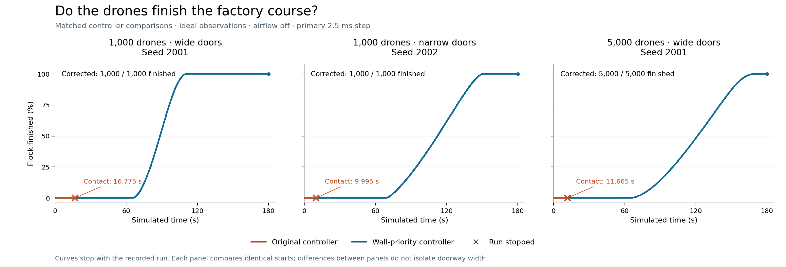

# Milestone 31 — full factory missions

The question is whether the wall-priority correction that helped during the first 20 seconds can carry a large flock through the complete factory. The controller is fixed; local 3D Boids and shared route guidance remain active. Airflow is off and observations ideal. These are simulation results, not physical validation.

## Plain-language finding

The corrected controller completes the whole course with every drone and no stop in 4/4 primary cases. The matched fresh-seed baselines complete in 0/3 cases. These small, prescribed case sets are not statistical safety rates.

The candidate passes these prescribed primary missions. Broader geometry, delayed observations and physical validation remain separate gates.

Complete passage does not mean the flock stayed fully connected throughout. The lowest sampled largest-group fractions were development seed 1501, 5,000 drones: 0.9998. The trial CSV retains every sampled minimum.

The prescribed finer-step checks meet all numerical criteria in 0/3 comparisons. The 5,000-drone check covers only the first 60 seconds.

A failed numerical criterion remains a limitation even when both runs complete the course. Read the separate trajectory, event and passage-count comparisons below before treating the motion as numerically resolved.

The development 5,000-drone case reuses an earlier starting flock. It is reported separately from the fresh-seed comparisons and does not receive a full-mission refinement in this protocol.

## Passage over time

Curves use the exact saved finish times and stop at the recorded end. These are individual matched cases, not averages or statistical safety rates. [Vector PDF](milestone-31-passage.pdf) · [Figure data and hashes](milestone-31-figure-sources.json) · [Plot reproduction](milestone-31-source/plotting.md).

## Results

|Role|Seed|Drones|Doors|Filter|Step ms|Horizon s|End s|Finished|Outcome|
|---|---:|---:|---|---|---:|---:|---:|---:|---|
|development|1501|5000|wide|wall-priority|2.5|180|180.00000|5000/5000|horizon reached|
|heldout|2001|1000|wide|baseline|2.5|180|16.77500|0/1000|obstacle contact envelope|
|heldout|2001|1000|wide|wall-priority|2.5|180|180.00000|1000/1000|horizon reached|
|heldout|2002|1000|narrow|baseline|2.5|180|9.99500|0/1000|obstacle contact envelope|
|heldout|2002|1000|narrow|wall-priority|2.5|180|180.00000|1000/1000|horizon reached|
|heldout|2001|5000|wide|baseline|2.5|180|11.66500|0/5000|obstacle contact envelope|
|heldout|2001|5000|wide|wall-priority|2.5|180|180.00000|5000/5000|horizon reached|
|refinement|2001|1000|wide|wall-priority|1.25|180|180.00000|1000/1000|horizon reached|
|refinement|2002|1000|narrow|wall-priority|1.25|180|180.00000|1000/1000|horizon reached|
|window-refinement|2001|5000|wide|wall-priority|1.25|60|60.00000|0/5000|horizon reached|

One contact stops the whole run. An unfinished drone is not an independently observed collision. Reaching the 180-second horizon with unfinished drones is not automatically a permanent jam. Completed drones keep flying and remain included in connectivity and contact checks.

## Numerical refinement

- **refinement-2001-1000-wide-wall-priority-0.00125** — full mission. Maximum synchronized position difference 5.1666098 m at 181 common saved times through 180.0 s. 1 cm criterion: False; first saved time at or above 1 cm: 35.0 s; event identity:True; count:True; end times:[180, 180]; combined criterion:False.
- **refinement-2002-1000-narrow-wall-priority-0.00125** — full mission. Maximum synchronized position difference 32.76746 m at 181 common saved times through 180.0 s. 1 cm criterion: False; first saved time at or above 1 cm: 30.0 s; event identity:True; count:True; end times:[180, 180]; combined criterion:False.
- **window-refinement-2001-5000-wide-wall-priority-0.00125** — first 60 s only; primary checkpoint used. Maximum synchronized position difference 7.9817922 m at 61 common saved times through 60.0 s. 1 cm criterion: False; first saved time at or above 1 cm: 31.0 s; event identity:True; count:True; end times:[60, 60]; combined criterion:False.

These comparisons cover exact recorded poses, not an error bound between frames. The 5,000-drone refinement cannot validate any later part of a full mission. Numerical agreement is not measured-flight agreement. The three new baseline contact cases use the primary step only; this milestone does not independently refine each baseline collision time.

## Does an unfinished flock still move?

|Trial|Final unfinished|Window s|Mean forward displacement m|Low-progress flag|
|---|---:|---|---:|---|
|development-1501-5000-wide-wall-priority-0.0025|0|not available|not assessed|not assessed|
|heldout-2001-1000-wide-baseline-0.0025|1000|6 to 16|5.5666|no|
|heldout-2001-1000-wide-wall-priority-0.0025|0|not available|not assessed|not assessed|
|heldout-2002-1000-narrow-baseline-0.0025|1000|not available|not assessed|not assessed|
|heldout-2002-1000-narrow-wall-priority-0.0025|0|not available|not assessed|not assessed|
|heldout-2001-5000-wide-baseline-0.0025|5000|1 to 11|4.4116|no|
|heldout-2001-5000-wide-wall-priority-0.0025|0|not available|not assessed|not assessed|
|refinement-2001-1000-wide-wall-priority-0.00125|0|not available|not assessed|not assessed|
|refinement-2002-1000-narrow-wall-priority-0.00125|0|not available|not assessed|not assessed|
|window-refinement-2001-5000-wide-wall-priority-0.00125|5000|50 to 60|4.1859|no|

This prespecified descriptive flag uses the final unfinished drones over the last complete 10-second recorded interval. A mean advance below 0.2 m raises the flag; it does not establish permanent deadlock. A null/blank flag means it was not assessed because no unfinished cohort or full ten-second window was available. It does not change when the simulation stops.

## Contact diagnostics

Obstacle and neighboring-drone IDs, actual states, requested velocities and motor targets are saved in [the pre-contact traces](milestone-31-precontact-commands.json). These are the actual preceding control update, not a reconstruction at the contact state. Motor targets differ from the lagged thrusts stored in the state. A compliant wall command does not guarantee pair safety or instantaneous tracking.

## Controller diagnostics

|Trial|Wall-request violations after filtering|Pair-request violations after filtering|Repair stop criterion unmet|Maximum wall deficit m/s|
|---|---:|---:|---:|---:|
|development-1501-5000-wide-wall-priority-0.0025|0|6790479|5|9.9955239e-11|
|heldout-2001-1000-wide-baseline-0.0025|8880|26763|not applied|0.35510901|
|heldout-2001-1000-wide-wall-priority-0.0025|0|219016|0|9.9924049e-11|
|heldout-2002-1000-narrow-baseline-0.0025|4065|11160|not applied|0.44506124|
|heldout-2002-1000-narrow-wall-priority-0.0025|0|904385|5|9.999308e-11|
|heldout-2001-5000-wide-baseline-0.0025|3621|246574|not applied|0.42589386|
|heldout-2001-5000-wide-wall-priority-0.0025|0|6801837|1|9.9979896e-11|
|refinement-2001-1000-wide-wall-priority-0.00125|0|219665|0|9.9924583e-11|
|refinement-2002-1000-narrow-wall-priority-0.00125|0|901445|4|9.9951424e-11|
|window-refinement-2001-5000-wide-wall-priority-0.00125|0|2944051|0|9.9961689e-11|

Violation counts use the frozen 1e-7 m/s threshold and count drone-control updates, not distinct drones or contacts. The repair stop criterion requires both feasible residual and a sufficiently small iterate change. Reaching its 512-iteration limit is reported even if the returned request is feasible; constraint residuals and mission outcomes remain separate. Wall priority can soften pair avoidance. Neither a low residual nor a completed mission establishes physical safety.

## Records and limits

[3D replay](milestone-31-lab.html) · [Frozen protocol](milestone-31-protocol.json) · [Method](milestone-31-source/method.md) · [Trial CSV](milestone-31-trials.csv) · [Artifact audit](milestone-31-artifact-checks.json) · [Interface checks](milestone-31-checks.json) · [Exact 20-second continuation check](milestone-31-continuation-check.json) · [Controller-output audit](milestone-31-control-audit.json) · [Post-hoc contact explanation](milestone-31-contact-analysis.json) · [Why the wall margin helps](research-wall-priority-physics-note.md).

All earlier numerical sources remain preserved. Count changes grow the starting cloud at fixed nominal spacing; they do not measure fixed-volume density scaling. The wide and narrow 1,000-drone scenarios use different seeds, so geometry and seed effects are not isolated across them; the controller comparisons within each scenario are matched. Two subprocesses may overlap, so elapsed times are not a scaling benchmark. No general navigation safety, physical accuracy, airflow validity or algorithmic novelty is established.
