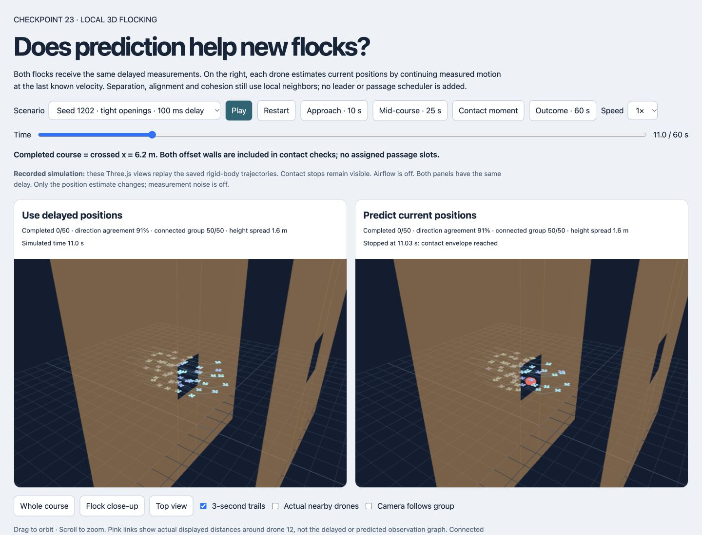
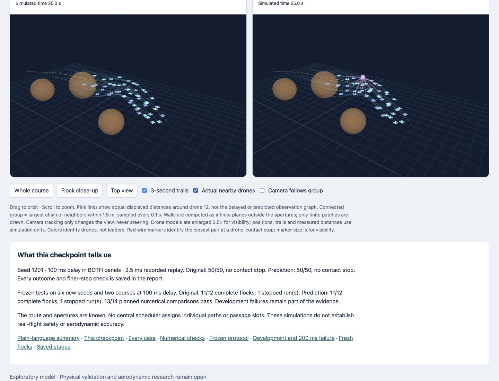
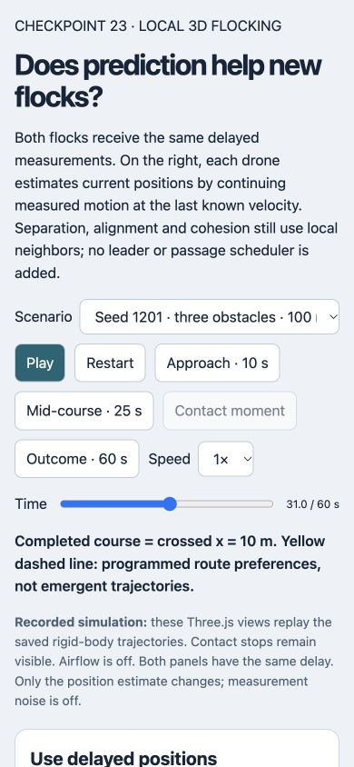
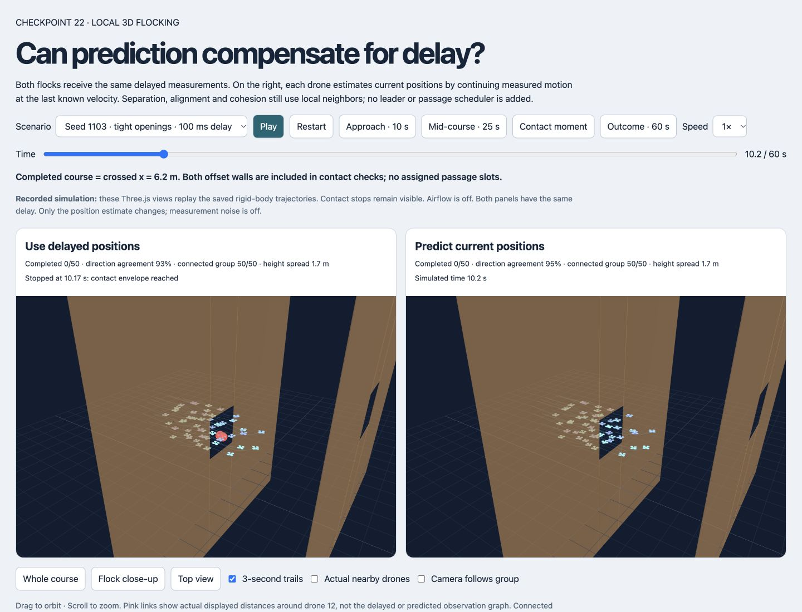

# Research block 22–23 — verification record

The flow under test: open the comparison → select a starting flock/course → inspect contact or jump to 60 s → compare the displayed outcomes with the saved simulation records.

## Summary

Software/artifact checks pass. Scientific acceptance is mixed:7/8 planned development comparisons and 13/14 planned fresh-study comparisons pass. The two separately declared audits pass. Neither controller achieves all fresh missions.

## Environment

- Local service: http://127.0.0.1:8875/outputs/research-results.html
- Unified Computer Use in-app browser, browser 2. No external browser driver was used.
- Desktop 1440×1100; mobile 390×844. Temporary viewport overrides reset.
- Milestone 22 and 23 use local Three.js modules and recorded simulation trajectories.

## Checks

|Check|Result|Evidence|
|---|---|---|
|Page identity and nonblank content|Pass|Correct 22/23 titles, meaningful controls, two rendered canvases.|
|Error overlays|Pass|No overlay in inspected DOM/screenshots.|
|Console health|Pass|No error/warning entries in tested replay tabs.|
|All fresh scenarios|Pass|All 12 selector choices display both final completion counts exactly as saved; see UI-case JSON.|
|Retained stops|Pass|22/1103/100 ms stops left;200 ms stops right.23/1202 stops right at 11.0275 s; outcome jump freezes failed panel.|
|Playback and controls|Pass|Play advances timeline and becomes Pause; Pause works. Scenario selection, time jumps, close-up and neighbor overlay exercised.|
|3D changing-height course|Pass|Slalom shown with 50 drones, trails and actual-distance overlay. Route preference is explicitly labeled.|
|Responsive layout|Pass|390px viewport has 390px document width, no horizontal overflow; controls wrap and panels stack.|
|Source/protocol/results|Pass|Frozen hashes match;54 planned runs and 32 exact recorded replays retained; paired starts match; poses agree with final states.|
|Historical raw regression|Pass|Six overlapping records match checkpoint 21 initial/final states, crossings, metrics and samples exactly.|

## Evidence and limitations

[Every fresh UI case](research-block-22-23-ui-cases.json) · [Artifact checks](research-block-22-23-artifact-checks.json) · [56-run block summary](research-block-22-23-summary.md).

The contact marker is enlarged for visibility. Models are 2.5× visual scale; measured positions/distances use simulation units. Pink links show actual displayed neighbor distances, not delayed/predicted observations. The viewer replays offline physics; UI responsiveness is not a physics or GPU benchmark. Other browsers, physical accuracy and arbitrary network conditions were not established.

Dataset access is a separate limitation: direct DOI retrieval returns a human-verification response; the browser access/inspection times out. This is not a local replay error. No raw physical observations were acquired.

## Commands and APIs

- Numerical studies:`milestone-22-source/study.cjs`,`audit-refinement.cjs`,`trace-refinement.cjs`;`milestone-23-source/study.cjs`,`audit-raw-failures.cjs`.
- Reports/replays:`research-block-22-23-tools/build-reports.py`,`build-summary.py`,`build-viewers.py`,`update-records.py`.
- Integrity:`research-block-22-23-tools/verify-artifacts.py`,`research-refresh-manifest.py`,`research-reproduce.py`.
- Browser:`reload`,`selectOption`,`getByRole(...).click`,`getAXState`, read-only DOM measurements, console logs, screenshots and viewport reset.

## Screenshots

