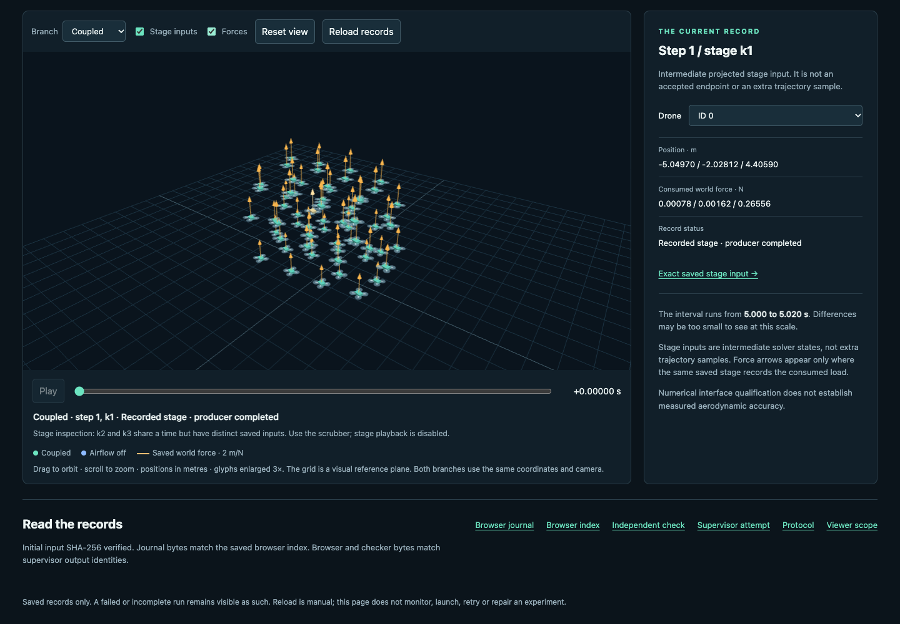
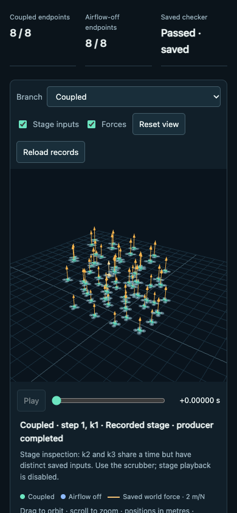

# Viewer QA — passed

Flow: saved qualification records → branch/endpoint/stage/force selection → matching rendered states and load arrows. Browser plugin/skill was unavailable; the existing Playwright and Chrome installation was used. No new dependency was installed. No scientific code was imported or rerun.

One bounded UI attempt completed **95 checks and 82 state selections** in about 5.55 seconds. Both owned Chrome exit and close reported code 0 with no signal. Scientific source/input/result bytes and viewer source bytes were unchanged during the test.

| Check | Result |
|---|---|
| Correct URL/title, meaningful page, no framework error overlay | Pass |
| Console health with actual results | Pass |
| All 18 branch endpoint selections and all 64 stage selections match saved positions | Pass at declared GPU display tolerance |
| Force arrows match consumed loads on the corresponding saved stage | Pass |
| Play/pause, scrub, orbit and reset | Pass |
| 1440×1000 desktop and 390×844 mobile; mobile horizontal overflow | Pass |
| Corrupted journal and missing-result states withhold motion and retain verified initial state | Pass |
| Frozen source, scientific results and viewer source preservation | Pass |

The parent visually inspected the desktop and mobile screenshots: drone bodies and force arrows are visible; controls and selected-record information are legible. Screenshots are scrolled to the workbench after control interactions. They do not document every scroll position. Other browsers/devices, arbitrary malformed JavaScript objects, and every possible failure state are untested.

Evidence: [prospective QA protocol](qa/attempt01/PROTOCOL.md), [test source](qa/attempt01/run.cjs), [report](qa/attempt01/report.json), [outer supervision](qa/attempt01/supervision.json), [before](qa/attempt01/immutable-before.json) and [after](qa/attempt01/immutable-after.json) inventories.

The viewer author's `VIEWER-MANIFEST.json` records the source-preparation state and parent syntax/link review before browser QA. This note supplies the later QA outcome; the historic source manifest was not rewritten after the test.

