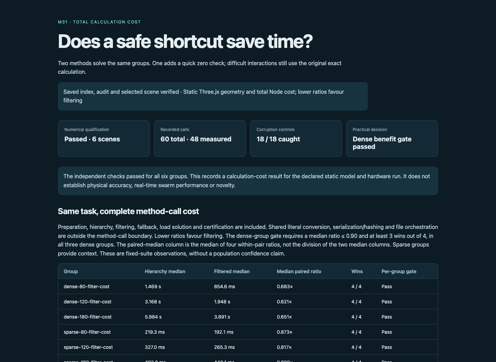
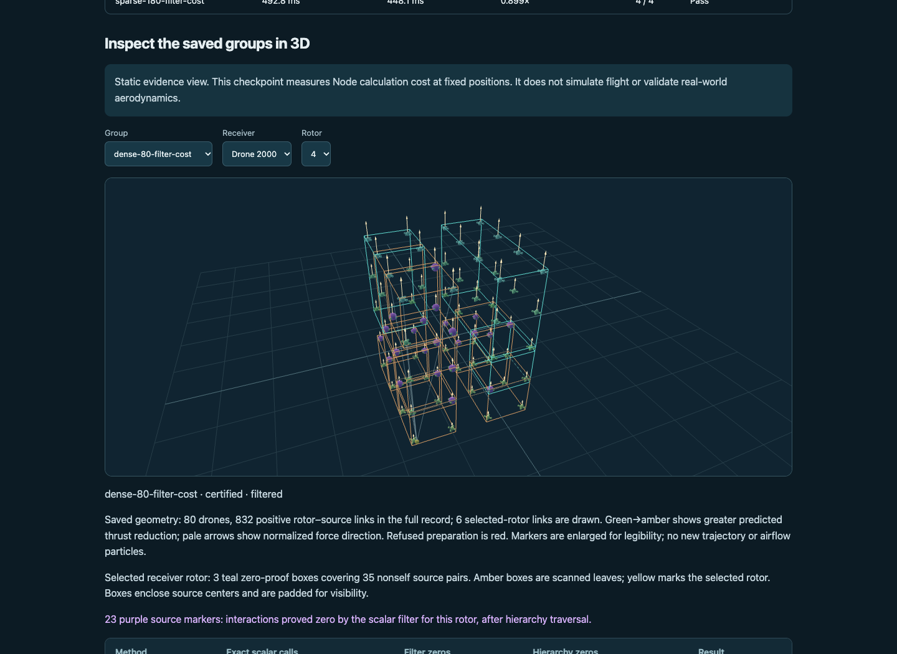
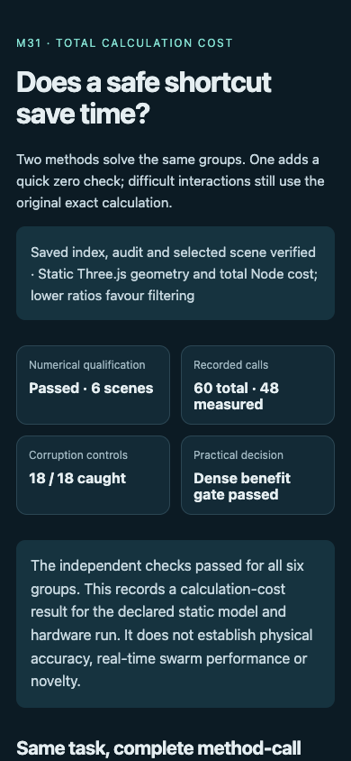
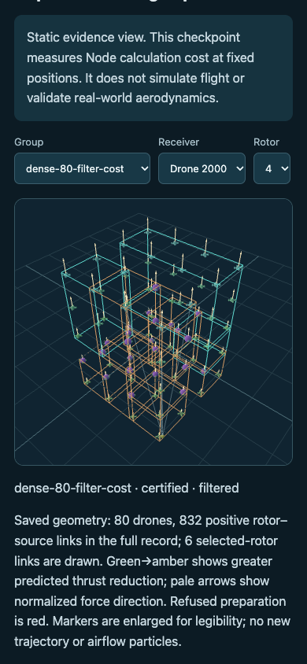

# Display QA closeout

## Findings and summary

Attempt01 failed on the 16th assertion after15passes in1.983seconds. Its bare-string rotor selector could match an option label instead of the intended value. No console error or warning occurred. Original sources, failure screenshot/report, library-source identity and the source-supported diagnosis are retained. The saved report did not capture the actual wrong selected value; no stronger observation is claimed.

The harness now uses explicit option values. Independent review also clarified the method-call timing boundary and the difference between paired medians and ratios of medians. Attempt02 passed **92checks in7.264seconds**, with zero errors/warnings. Both display allocations are closed. No scientific source or evidence changed and neither display run imported a scientific module.

## Environment

URL: http://127.0.0.1:8876/research/m31-filter-cost-2026-10-17/viewer/ . Chrome155.0.8059.80; desktop1440×1050 and mobile390×844. Browser plugin not available; installed Playwright/Chrome fallback, with no installation. The user requested committed research traces, so reports, screenshots and exact source snapshots for both attempts remain in this package.

## Verified changes and interaction loop

The flow under test is: verified saved checkpoint loads → choose each of six groups and first/last receivers and rotors → real Three.js geometry and recorded decision counts update → orbit responds → corrupted evidence hides claims.

| Check | Final result |
|---|---|
| Intended URL/title and meaningful content | Pass |
| No framework error overlay | Pass |
| Console health | Zero errors/warnings |
| Six timing rows, qualification and18controls | Pass |
| Every saved group and all2,280rendered center components | Pass |
| Receiver/rotor selections and corresponding filter-zero, positive-link and hierarchy counts | Pass |
| All six visible timing ratios | Pass |
| Orbit interaction and visible Three.js canvas | Pass |
| Local links and mobile page overflow | Pass |
| Corrupt binding/index/checker/scene hides claims | Pass |

The parent visually inspected all four final screenshots and the failed screenshot. Desktop/mobile text is legible; the group images show the saved three-dimensional arrangement, teal hierarchy boxes, purple additional filter zeros and pale force arrows. The displayed positions are saved fixed states, with enlarged markers. No trajectory, airflow simulation or physical validation is implied.

## Commands and remaining risk

`qa/run.cjs` uses the installed Playwright chromium launcher, navigation, explicit selectOption values, DOM/canvas-state checks, saved JSON comparison, mouse orbit, viewport changes, screenshots and route interception for corrupt evidence. Runtime and output paths are supplied through local environment variables. `node --check` verified harness syntax before each allocation. See attempt source snapshots for the exact invoked code.

Only this Chrome version, the two viewport sizes and saved cases were covered. Arbitrary unsaved inputs, other browsers and live flight were not tested. Optional Browser-plugin installation could improve future in-app inspection; it is not required to inspect this checkpoint. No further QA execution is allocated here.

## Screenshots

