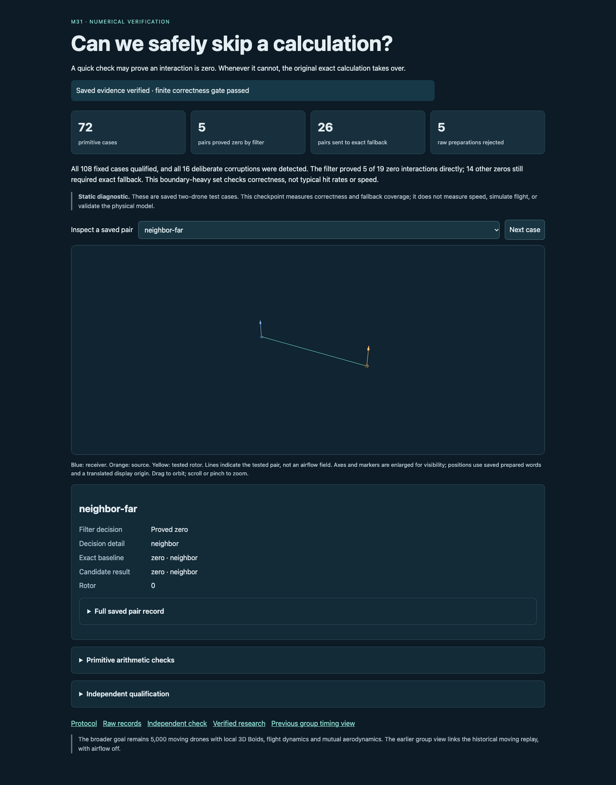
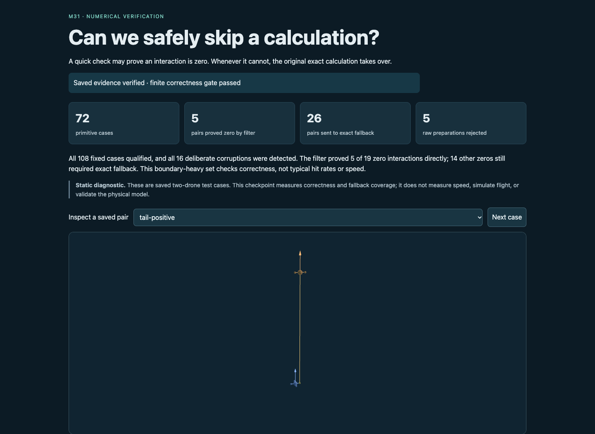
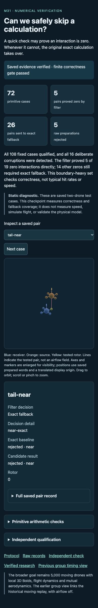
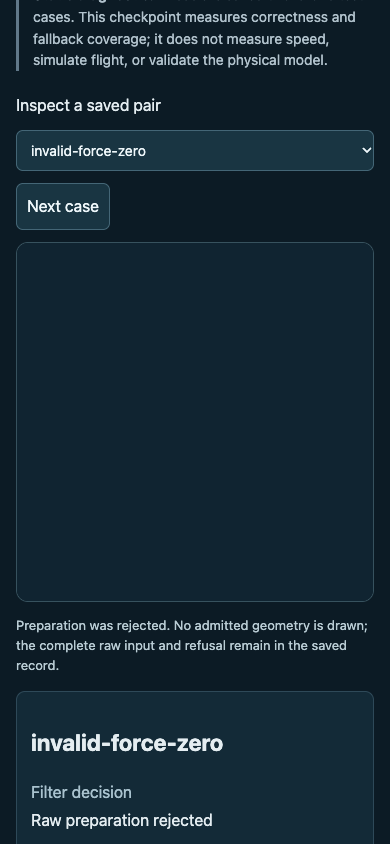

# Saved display QA closeout

The flow under test is: saved checkpoint loads and verifies its evidence → select any of 36 pairs, orbit or advance → geometry and the saved decision agree; invalid preparation clears geometry and corrupted evidence hides claims.

## Findings and repair

Attempt 01 failed before any checks completed (6.785 seconds): the page omitted the import map required by OrbitControls' bare `three` import. A favicon request also returned 404. The original source snapshot, report and screenshot are retained. The display-only repair adds the local import mapping and data favicon; the QA readiness timeout now passes its intended 25-second option in the correct argument position. Scientific source and data are unchanged.

Attempt 02 passed all 101 checks in 2.024 seconds, with zero browser errors or warnings. Both display allocations are closed; no third run is permitted in this package.

## Environment and verified behavior

URL: http://127.0.0.1:8876/research/m31-filter-design-2026-10-17/viewer/ . Chrome 155.0.8059.80; desktop 1440×1050 and mobile 390×844. Browser plugin not available; used installed Playwright/Chrome without installation. The user requested committed research traces, so source snapshots, QA reports and screenshots are retained here.

| Check | Final outcome |
|---|---|
| Page identity and meaningful content | Pass |
| Framework error overlay | Absent |
| Console errors/warnings | None |
| All 36 pair choices and saved decisions | Pass |
| Visible Three.js canvas, orbit and next control | Pass |
| Invalid preparation clears geometry | Pass |
| 72 primitive rows and 16 corruption controls | Pass |
| Local links and mobile overflow | Pass |
| Corrupt binding, raw data or checker hides claims | Pass |

The primary agent visually inspected desktop, positive-fallback, mobile and mobile-refusal screenshots from attempt 02. They show legible evidence, 3D markers and axes, and an empty scene with explanation for refused preparation. Markers are intentionally enlarged; this is a static diagnostic, not a flight animation or physical measurement. Original failed display evidence remains in attempt-01/.

## Method and remaining limits

The committed `run.cjs` uses Playwright navigation, page/console assertions, selection, next-button and orbit interactions, viewport changes, screenshots and intercepted corrupt responses. Exact scripts and page sources for both runs are in the corresponding attempt source directories. No model, candidate or scientific checker was executed by display QA. Other browsers, other viewport sizes and arbitrary unsaved inputs were not tested. Browser-plugin installation is optional for future in-app inspection; it is not needed to inspect this saved result.

## Screenshots

