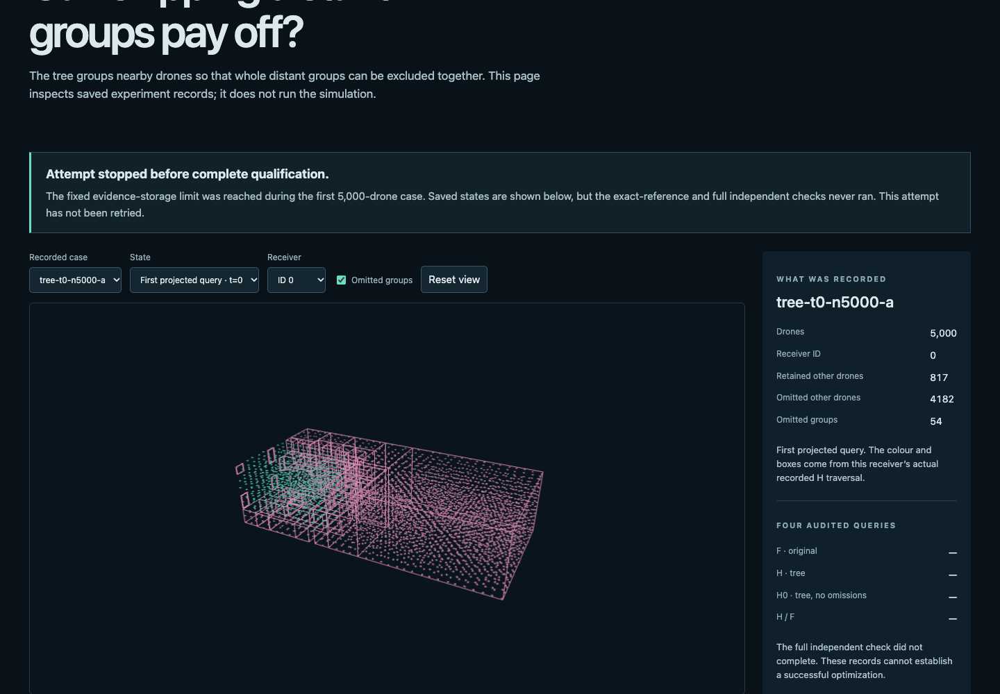
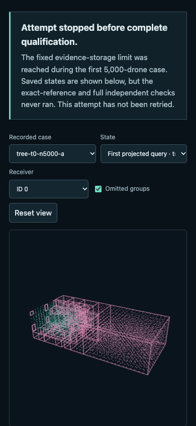

# Saved-record viewer QA

**Passed:** 43 checks in one bounded UI attempt. The supervisor completed in 10.19 seconds; the browser test body reported 5.81 seconds. There were no scientific calls and no relevant actual-data console errors. Source, result and display-file inventories were identical before/after.

The flow was: open the saved-record page, select each reached case and available state, select each of five fixed receivers, compare rendered positions/counts/retained sets with the display data, then exercise omission boxes, orbit/reset and failure states. Five state selections and 25 receiver selections were checked. The first 5,000-drone case is the default; only its recorded initial-query frame is available.

| Check | Outcome |
| --- | --- |
| URL/title, meaningful page, no framework overlay | Pass |
| All available case/state/receiver data and positions | Pass |
| Later endpoint hides stale omission geometry | Pass |
| Omitted-box checkbox and orbit/reset interaction | Pass |
| Desktop 1440×1000 / mobile 390×844 | Pass; no horizontal overflow |
| Missing/corrupt pins and corrupt data | Geometry withheld; no invented swarm |
| Actual-data console | No relevant errors |
| Scientific and display artifacts preserved | Exact inventories match |
| Owned Chrome root exit/close and guardian | Observed zero root codes; guardian reaped |

The Browser plugin was unavailable; the already installed, pinned Playwright/Chrome fallback was used. The server on port 8876 was unchanged. Detailed checks, inventories, supervisor records and screenshots are under `qa/attempt01/`.

Parent visually inspected the desktop and mobile workbench screenshots. The 5,000-drone cloud, actual omission boxes, controls and visible incomplete-qualification notice rendered without overlap. Initial screenshots also remain in the record. This checks display fidelity, not any scientific conclusion or simulation rate.

`export-saved.py` produced the three actual-data files and their provenance. The index's explanatory sentence was editorially clarified afterward using the diagnosed storage failure; geometry, source pins and qualification flags were unchanged. The final viewer manifest binds that displayed text and all exported data. The viewer and export code are separate from the frozen scientific source manifest.

Remaining limits: only the two listed viewports and pinned Chrome were tested; no accessibility audit, other-browser result or live-flight claim. The underlying fresh run is still unqualified because the planned reference and full checker did not launch.

