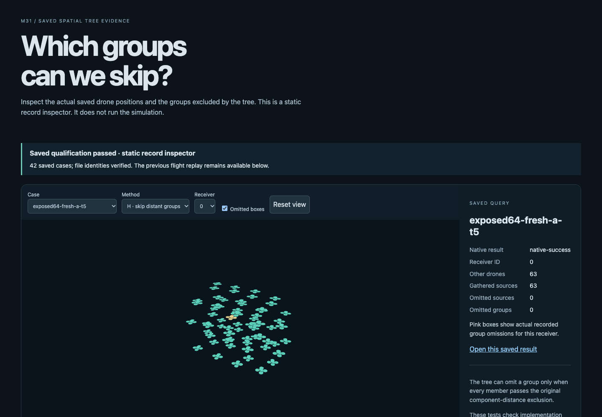
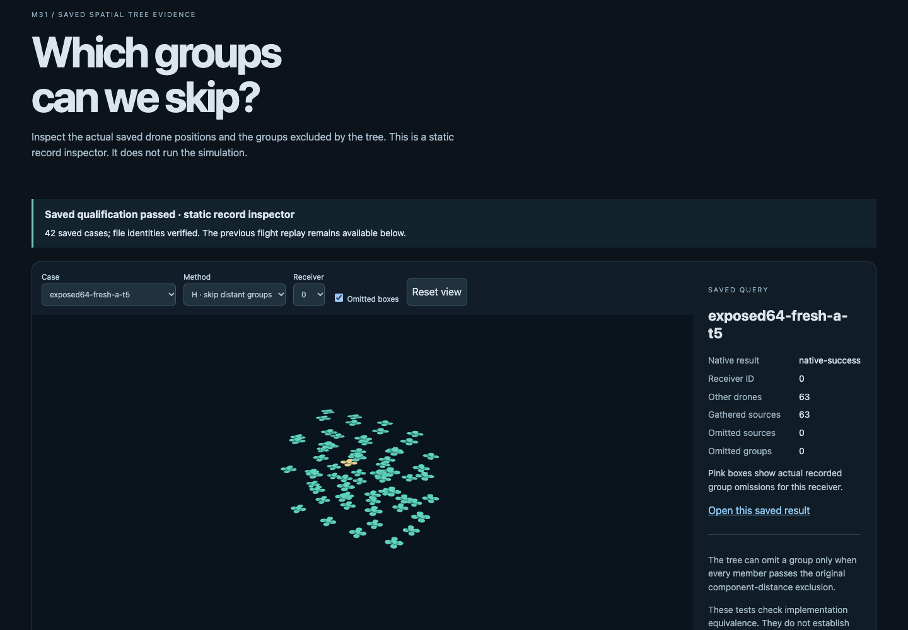
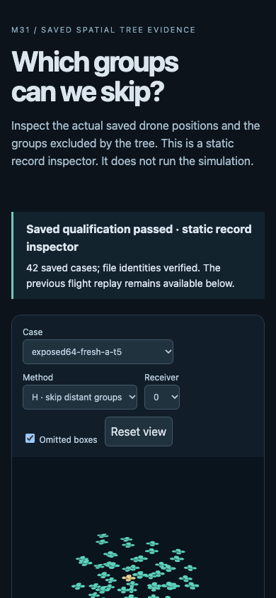
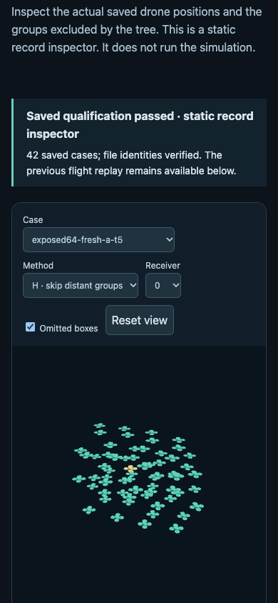

# Saved-record inspector QA

**Passed on one UI-only attempt.** The flow was saved records → case/method/receiver → actual saved positions, retained sources and omitted groups. Browser plugin not available; existing pinned Playwright and Chrome were used on localhost 8876. No scientific module, experiment or checker was executed by the viewer or UI tests.

Environment: desktop 1440×1000 and mobile 390×844. The existing server was unchanged. Selected installed Chrome/Playwright/Node/Python bytes were checked against retained runtime pins. One fresh private profile and one owned browser root were used; root exit/close both reported 0, and the guardian was released and reaped. No all-helper OS containment or memory-limit claim is made.

| Check | Result |
| --- | --- |
| Page identity / meaningful content / no framework overlay | Pass |
| Console health on actual data | No recorded errors |
| All 42 cases × three methods | 126 selections matched saved canonical positions, retained indices, omissions and status |
| Exposed64 H receiver selections | All 64 matched saved records |
| Box visibility / orbit / reset controls | Passed; orbit changed the recorded camera position |
| Desktop and mobile initial/workbench screens | Captured; parent visually inspected screenshots |
| Mobile horizontal overflow | None at 390 px |
| Missing/corrupt work records | Empty withheld display; selection disabled |
| Scientific source/result and viewer source preservation | Before/after inventories equal |

Sources: [prospective UI protocol](qa/attempt01/PROTOCOL.md), [test script](qa/attempt01/run.cjs), [report](qa/attempt01/report.json), [supervision](qa/attempt01/supervision.json), [before](qa/attempt01/immutable-before.json), [after](qa/attempt01/immutable-after.json). The script used Playwright navigation, option selection, checkbox toggles, orbit drag, screenshots and two intercepted failure pages. QA took 5.596 s through its report timestamp; outer supervision 10.146 s. Neither is science performance.

Limitations: one browser/runtime and two viewports; no accessibility audit or cross-browser coverage. Coincident fixture drones overlap, and zero-volume omitted bounds may be visually degenerate; the exact counts remain displayed. The 64-drone regression has no omissions, so its correct view has no pink group boxes. Retained candidates can still contribute zero; colors do not label physical wake neighbours. Static snapshots provide no new flight trajectory.

The user's request for committed audit artifacts authorizes saving this report and screenshots in the repository. The detailed QA record is retained here so the milestone summary can remain concise.

