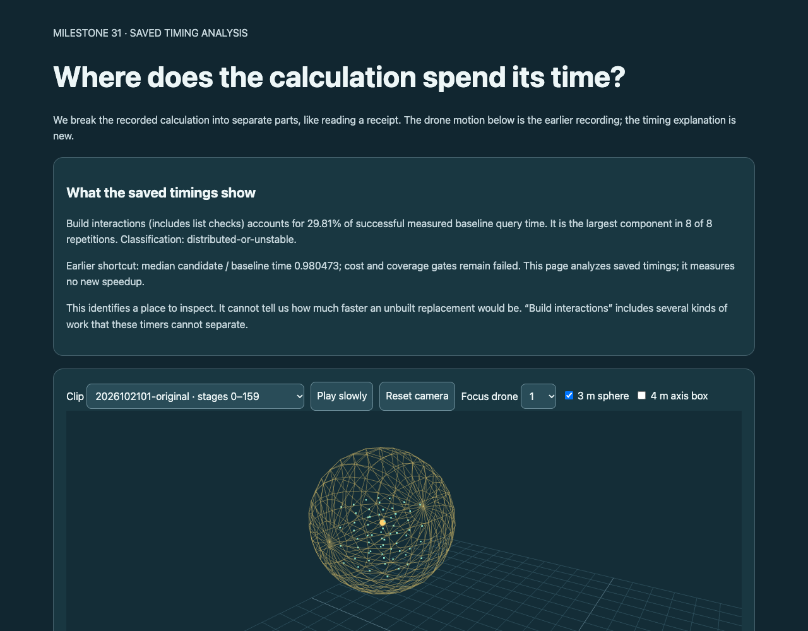
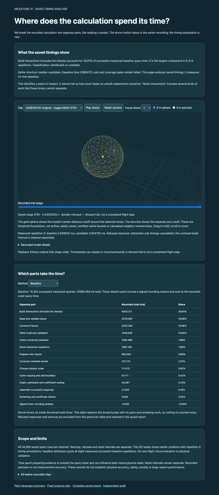
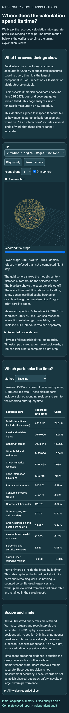

# Three.js evidence view — QA record

Summary: PASS. Existing recorded drone positions now carry audited repetition-zero F/C timing annotations. The page also displays the pooled successful-query phase table, consistent largest component and unchanged earlier failed gates. No new flight or physics is implied.

The flow under test is: open the phase-attribution viewer, select a clip/stage/method, and see the matching recorded 3D state and audited timing evidence; alter a bound data response and see the page refuse to render.

Environment: http://127.0.0.1:8876/research/m31-phase-attribution-2026-10-23/viewer/ ; installed Chrome with existing Playwright. Browser plugin not available. No dependencies installed. Desktop 1280x1000; mobile 390x844. The existing server was retained. Frozen Node launcher is pinned; browser/Python/Playwright are not hermetically pinned.

| Check | Result |
| --- | --- |
| Intended page title and meaningful content | Pass |
| Blank-page and framework-overlay check | Pass |
| All 1,920 saved position/status/count records | Pass |
| All 1,920 paired timing annotations | Pass |
| Exact source-data ranking and displayed aggregate table, F and C | Pass |
| Inherited refusal and unavailable timing labels | Pass |
| Playback, clip/stage/focus controls | Pass |
| Sphere/box toggles, camera orbit/reset | Pass |
| Desktop/mobile page overflow | Pass |
| Altered evidence rejection | Pass |
| Console/page/HTTP errors and warnings | None observed |

Interaction loop: select clips and slider positions; compare rendered positions/status/timing with saved records; change method to candidate and baseline and check both tables; play/pause, focus a different drone, toggle threshold shapes, drag the visible canvas and reset the camera. Mutated timing evidence was rejected with a visible error and no canvas. Exact assertions and screenshots are retained in ui/qa.json and ui/.

The parent inspected first-viewport.png, desktop.png and mobile.png. The result is readable, controls remain within the viewport and the refusal is visible. Mobile is a long scrolling page; full-page screenshot display may downscale it. Small signed timer residue rounds to -0.000 ms/-0.00%; that preserves the sign, not a physically negative duration claim. Threshold spheres/boxes are illustrations, not airflow or safety zones.

Command/API evidence: single frozen source/supervise.py ui invocation; installed Playwright chromium.launch/newPage/goto, selectors/evaluate, pointer drag, screenshots and response interception. No retry or post-QA source change. The user requested committed milestone traces, so these records are deliberately retained in the repository.

Remaining limits: only the installed Chrome and these two viewport sizes were checked; no new scientific execution, physical validation, other-browser or assistive-technology validation. The Browser plugin could offer an integrated future testing workflow; it was not installed for this checkpoint.

## Screenshots

