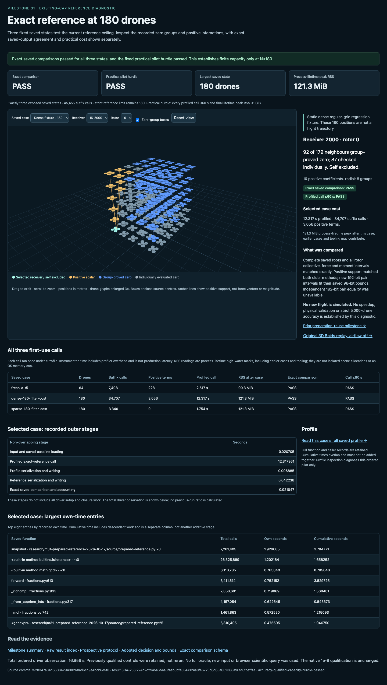
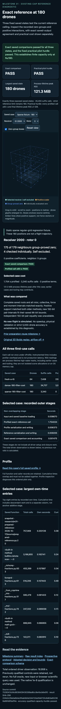

# Prepared-capacity viewer QA

**Passed on the first UI-only attempt.** The viewer displays the actual new
64/180/180 saved references, with exact-comparison and practical-hurdle outcomes
kept separate. Dense and sparse180 are labeled static regression grids. The64
control is labeled a saved local Boids state with airflow off and links the
original replay. Geometry shows saved poses, self exclusion, zero groups and
positive support; no force vector or new trajectory is generated.

Environment: existing route
`http://127.0.0.1:8876/research/m31-prepared-capacity-2026-10-17/viewer/`;
1440×1050 desktop and390×844 mobile. Browser plugin was unavailable; the parent's
bounded allocation used installed pinned Playwright1.62.1 and
Chrome155.0.8059.80. No server restart or scientific import/query occurred.

The renderer changed only its old64-instance pool to180 capacity, actual emitted
pose counts and active instance count. The prior stylesheet was reused with
small flag/table additions. New app/binding/index text reads actual case records,
profiles and result flags. It displays selected profiled time, process-lifetime
RSS, non-overlapping outer stages and separately labeled own/cumulative profile
times. It does not interpret profiled time as production speed or cumulative
times as additive stages.

| Check | Result |
| --- | --- |
| Correct page identity and meaningful content | Pass |
| No framework error overlay | Pass |
| Three fixed rows, actual accuracy/capacity flags and final RSS | Pass |
| All three cases, receiver0/last, all four rotors, both viewports | 48/48 selections pass |
| Every uploaded saved position; self exclusion and zero/scalar/positive IDs | Pass for every selection |
| Actual body/box counts, reuse, selected elapsed and lifetime RSS | Pass for every selection |
| Outer-stage and saved-profile tables | Present with expected row counts |
| Desktop/mobile horizontal page overflow | None |
| Toggle boxes, orbit and reset camera | Pass |
| Invalid selection | Geometry cleared; controls disabled |
| Changed record, missing index, hash-valid failed accuracy | All fail closed before geometry |
| Hash-valid capacity miss with accuracy qualified | Qualified180 geometry retained; separate PASS/MISS flags |
| Main/corrupt/failed-accuracy/capacity-miss console and requests | No errors, warnings or failed requests |
| Missing-index fixture | Exactly one expected HTTP404 error; no other issue |
| Frozen source/results/viewer preservation | All788 inventoried files unchanged |
| Browser cleanup | Graceful exit/close0, reaped, private profile removed |

The interaction loop was load -> select each case -> select first/last receiver
-> select rotor0–3 -> compare uploaded positions and saved coverage/cost fields,
repeated at both viewport sizes. Additional interactions tested box visibility,
orbit/reset and invalid selection. Four extra pages tested corrupt/missing
evidence, failed accuracy and a separate capacity miss. The last two fixtures
changed only isolated response bytes and their test binding hashes; no disk
source or scientific evidence was modified.

All81 assertions passed. UI work took8.216seconds and the supervisor completed
in12.764252seconds, inside its120-second and16MiB allocation. There was no second
attempt. The numerical index is pinned by SHA256
`224b2c29a5a6b4a3f4ab5bfa5344124a0fe6720c6d63a652368a96fd6fbeff4e`;
the viewer binding SHA256 is
`5aa83d9c3469c07ec5297b6252a30d0e27fac324242ebd56e0e5535645022750`.

- [Full QA report](qa/attempt01/report.json)
- [Supervisor receipt](qa/attempt01/attempt.json)
- [Source/results before](qa/attempt01/immutable-before.json) and
  [after](qa/attempt01/immutable-after.json)
- [Fixed UI protocol](qa/attempt01/PROTOCOL.md)
- [Viewer source inventory](SOURCE-PINS.json)

Both screenshots were opened and visually inspected. The desktop dense180
lattice, selected receiver and positive support are clear; controls, flags and
cost/profile tables are readable. Mobile controls wrap, the sparse180 view fits,
identity text wraps, and wide data tables remain in their own horizontal scrollers
without page overflow. No primary-control overlap, blank canvas or error overlay
was observed. This covers two viewport sizes and one pinned browser, not a full
accessibility or cross-browser audit. UI QA adds no numerical or physical claim.

Command sequence: saved-only bind.py -> pinned isolated Python supervisor ->
reviewed Node/Playwright script -> one owned local Chrome root -> saved-data
interaction/failure checks -> graceful cleanup and pin verification. Browser
plugin installation could provide the dedicated browser workflow in future UI
work; no dependency was installed or changed here.

## Screenshots

Desktop, dense180:

Mobile, sparse180:

