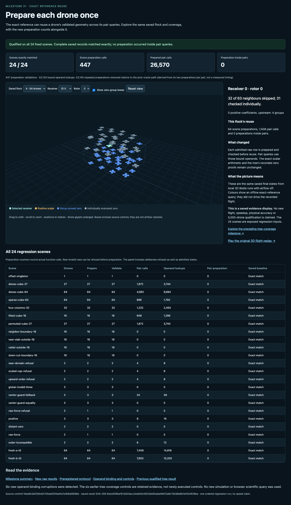
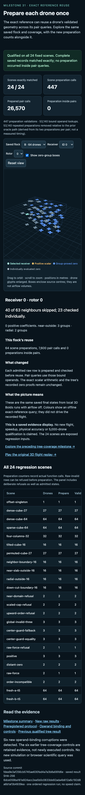

# Prepared-reference viewer QA

**Passed on the first UI-only attempt.** The new page renders the actual saved
64-drone states, unchanged zero/scalar/positive coverage, and the new preparation
reuse counters. It displays 24/24 exact scene matches, 447 scene preparations,
26,570 prepared pair calls, and zero preparations inside pair queries. It labels
the derived 53,140 avoided prior preparations separately from measured timing.

Environment: existing local route
`http://127.0.0.1:8876/research/m31-prepared-reference-2026-10-17/viewer/`;
1440x1050 desktop and390x844 mobile. Browser plugin was unavailable, so the
explicitly authorized attempt used installed pinned Playwright1.62.1 and
Chrome155.0.8059.80. No server restart, numerical import, simulation, new exact
reference or native scientific query occurred.

| Check | Result |
| --- | --- |
| Correct page URL/title and meaningful content | Pass |
| No framework error overlay | Pass |
| All24 table rows and actual aggregate counters | Pass |
| Both saved states, receivers0/63, all4 rotors, both viewports | 32/32 selections pass |
| All64 uploaded positions and saved zero/scalar/positive IDs | Pass for every selection |
| Selected-scene reuse counters and group-box counts | Pass for every selection |
| Desktop/mobile horizontal page overflow | None |
| Box toggle, orbit and camera reset | Pass |
| Invalid selection clears geometry and disables controls | Pass |
| Changed saved record, missing index, hash-valid failed result | All fail closed before geometry rendering |
| Main/corrupt/failed-result console and requests | No errors, warnings or failed requests |
| Missing-result fixture console | One expected HTTP404 error; no other error/warning/failure |
| Source, science, bound evidence and viewer preservation | All705 inventoried files unchanged |
| Browser/profile cleanup | Graceful root close; exit/close0; reaped; private profile removed |

The fixed interaction loop was load -> select A/B -> select receiver0/63 -> select
rotor0–3 -> check saved positions/coverage/counters, repeated at desktop and mobile
sizes. Additional checks toggled boxes, changed and reset the camera, and exercised
the four invalid/evidence-failure paths. The failed-result fixture re-bound only
isolated response bytes to a deliberately failed result; disk evidence remained
unchanged. This checks the qualification predicate separately from hash rejection.

All62 assertions passed. Node UI work took7.250 seconds; the parent supervisor
closed in11.885 seconds, within the120-second/16MiB allocation. The report contains
the request inventory, selection counts, screenshots and exact cleanup evidence:

- [QA report](qa/attempt01/report.json)
- [Supervisor receipt](qa/attempt01/attempt.json)
- [Immutable inputs before](qa/attempt01/immutable-before.json) and
  [after](qa/attempt01/immutable-after.json)
- [Fixed UI protocol](qa/attempt01/PROTOCOL.md)
- [Viewer source inventory](SOURCE-PINS.json)

Screenshots were opened and visually inspected after the run. Desktop controls,
counts, full3D view and24-row table are readable. Mobile controls wrap, the3D view
fits the viewport, the evidence identity wraps, and the wide table remains inside
its horizontally scrollable container without page overflow. No overlap, clipping
of primary controls, blank canvas or error overlay was observed. This is a finite
display check in two sizes, not an accessibility audit or cross-browser guarantee.

The implementation copies the preceding renderer and stylesheet unchanged and
adds the new result binding, counters, text and failure gates. Command path:
isolated bundled Python supervisor -> reviewed Node/Playwright script -> owned
local Chrome root -> saved-data UI checks -> graceful cleanup and pin verification.
Runtime/source pin checks and all artifacts are retained. No second attempt was
needed.

## Screenshots

Desktop:

Mobile:

