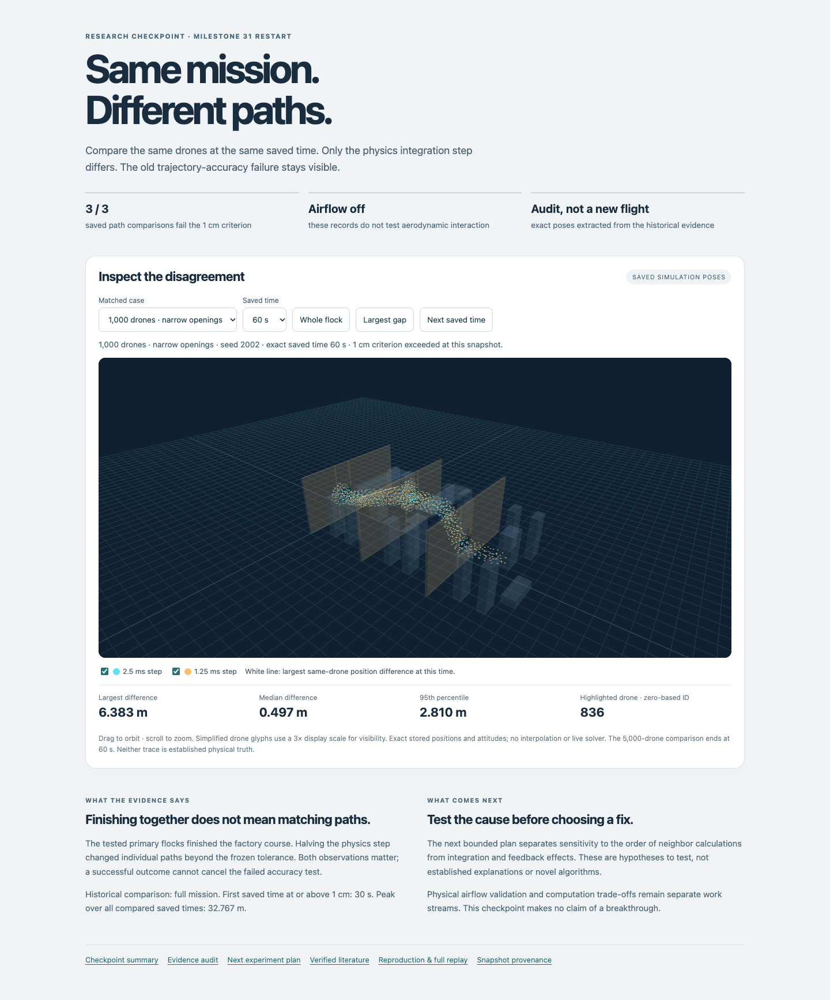
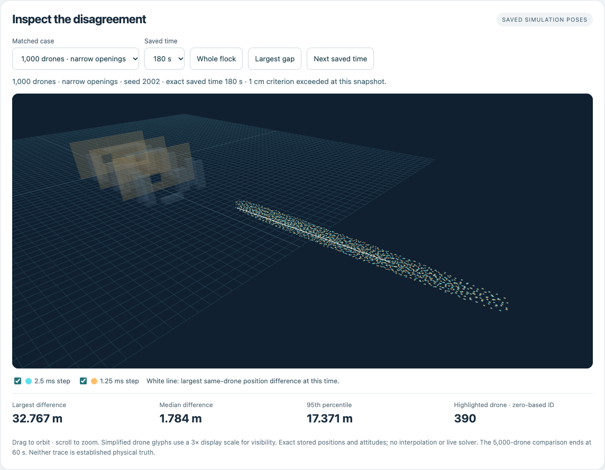
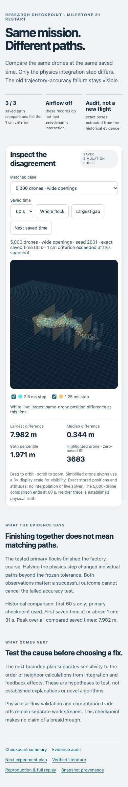

# Evidence-viewer verification

The flow under test is: load the checkpoint viewer → select a historical case and exact saved time → inspect both fleets, the largest same-drone gap and corresponding statistics.

**Passed** on installed Chrome 155.0.8059.40, automated with Playwright 1.62.1. Viewports: desktop 1440 × 1000; mobile layout 390 × 844. The Browser plugin was not available. Playwright's bundled browser was absent, so the existing Chrome installation was used without installing dependencies. Local entry route: `/research/m31-restart-2026-10-15/viewer/`, served with Python's HTTP server.

| Check | Evidence |
|---|---|
| Correct identity and meaningful rendered screen | Expected title, header, status and WebGL canvas found; no framework error overlay |
| Normal console and requests | Zero page errors, warnings, console errors or failed HTTP responses in the completed normal-flow check |
| Data selection | All 14 saved case/time combinations match provenance metadata and worst-drone IDs; no 180 s option for the 5,000-drone case |
| Camera and visibility | Whole-flock and largest-gap controls alter rendered scene; hiding each fleet changes canvas pixels; mouse drag changes orbit |
| Time control | Next saved time wraps from 180 s to 0 s for the 1,000-drone case |
| Mobile layout | No horizontal overflow at 390 px; case/time controls, scene, metrics and links remain visible |
| Documentation | All six footer links return HTTP 200 |
| Integrity failure | Deliberately corrupting one snapshot byte is rejected with a visible checksum error; controls remain disabled |
| Scientific data | All displayed maxima independently recomputed by the generator agree with the historical comparisons within 1e-10 m; saved poses retain original Float64 values and xyz/xyzw layout |

One intermediate browser check found a report link returning 404 while report integration was incomplete. After the report was copied, the same full interaction check passed. No data or scientific threshold changed. The initial loading state was also hardened by disabling fleet toggles until data verification completes.

Commands used: Playwright CLI version check and Chrome-channel screenshot, followed by a temporary Playwright script covering the interactions above. [Machine-readable results](qa.json) retain the observed browser version, checks and empty normal error lists. The temporary harness was outside the repository; no browser profile, trace, local machine path or account information is published.

This verifies a recorded-state viewer. It is not a solver benchmark, real-time simulation claim, physical-validation result or a test of every browser/device. Mobile viewport testing does not imply testing a physical phone. The enlarged glyphs are illustrative; their centers and orientations use stored simulation poses.

