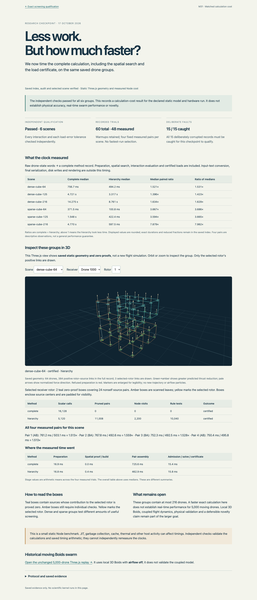
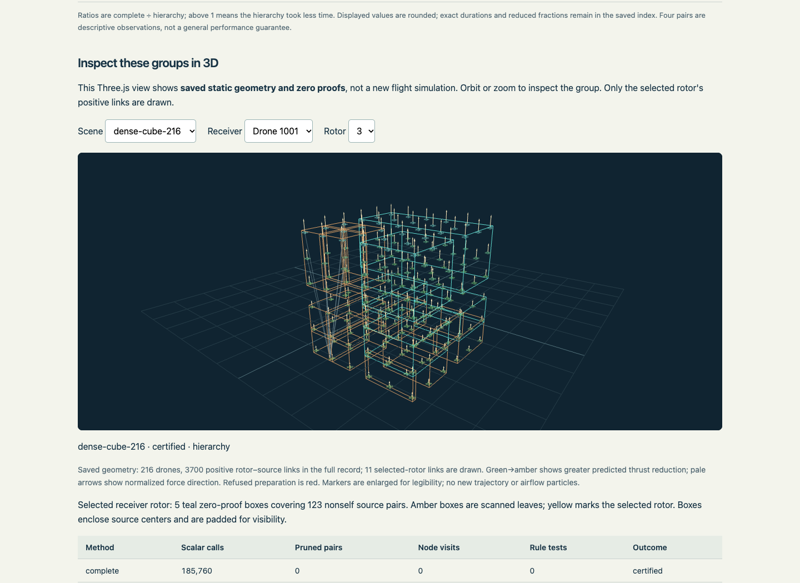
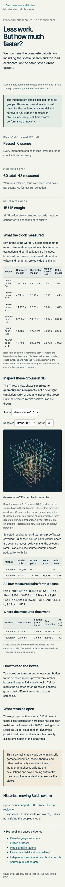
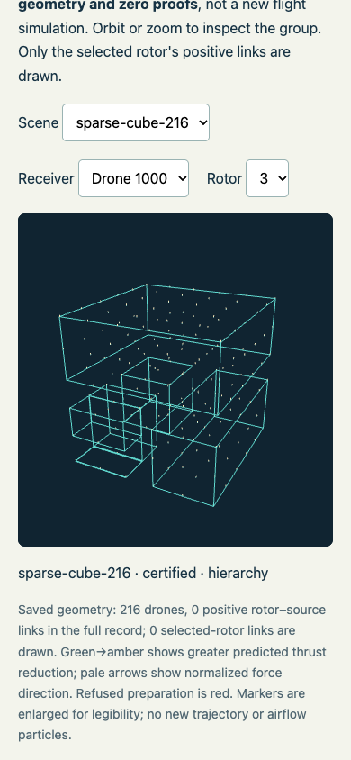

# Saved Three.js cost viewer: display QA passed

The flow under test was: the saved checkpoint loads, all six scene selections show the matching geometry and timing records, receiver/rotor selections change the displayed proof, and orbit controls respond.

One display-only allocation ran6.627seconds and passed58checks, with zero console errors or warnings. No second display attempt was needed. The scientific kernel and independent checker were not rerun. Exact attempt source, report and screenshots are retained under attempt-01-source/ and attempt-01/.

Environment: http://127.0.0.1:8876/research/m31-screening-cost-2026-10-17/viewer/ ; desktop1440x1050 and mobile390x844. Browser plugin not available; existing installed Playwright and Chrome were used. No dependencies were installed. The task explicitly requests committed artifacts, so QA source/screenshots remain in this repository.

| Check | Result |
|---|---|
| Page URL/title and meaningful content | Pass |
| Six scene choices and six timing rows | Pass |
|60trials and static/airflow-off/timing scope disclosures | Pass |
| Three.js canvas and no framework overlay | Pass |
| All six scene IDs and64/125/216drawn drone counts | Pass |
| All four paired observations and two stage rows per scene | Pass |
| Receiver and rotor control updates | Pass |
| Orbit camera change | Pass |
| Evidence/back/history links | Pass |
| Mobile page overflow | None |
| Console errors/warnings |0/0|
| Corrupted binding, model or scientific shard | Claims hidden; display stopped |

Parent visual inspection covered desktop and mobile full-page screenshots plus dense216and sparse216geometry screenshots. Text, controls and proof boxes render without overlapping or missing content. Wide tables scroll inside their own containers on small screens. Only selected-rotor positive links are drawn to keep the dense geometry legible; the full link count is separately labeled.

Checks used the existing Node/Playwright script qa/run.cjs, installed Chrome headless, page navigation, scoped selection controls, canvas/camera state attributes, console capture, screenshots, link requests and three deliberately corrupted HTTP responses. The latter are display rejection tests only, not new scientific controls.

Unverified: other browsers/viewport sizes, live aerodynamics, simulation throughput and moving coupled5,000-drone behavior. The displayed timing values come from saved Node records; this page is not a browser computation benchmark. The Browser plugin could provide integrated browser inspection in future work; it was absent for this check.

## Screenshots

